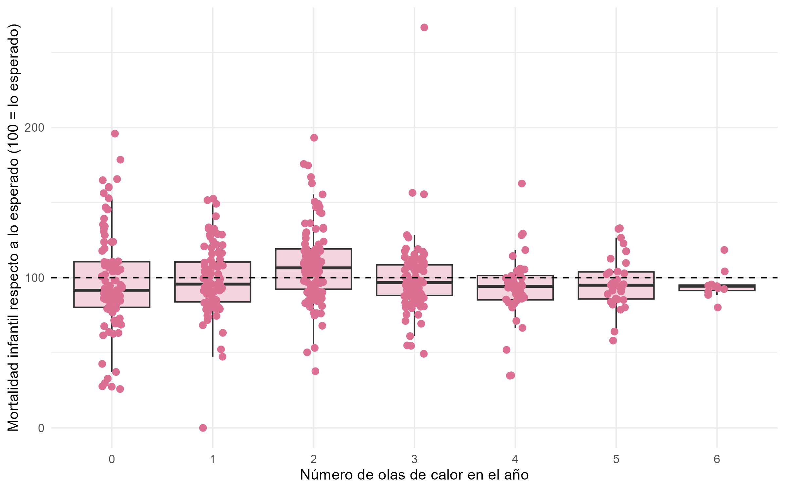
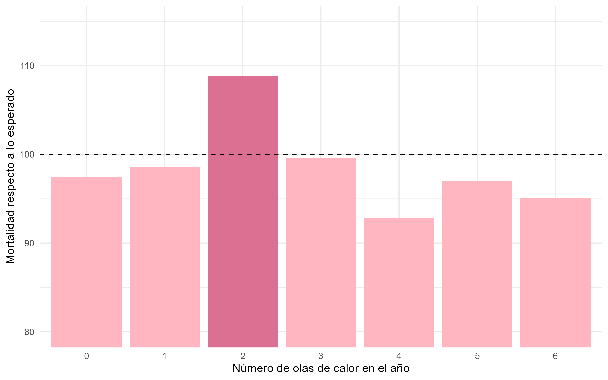
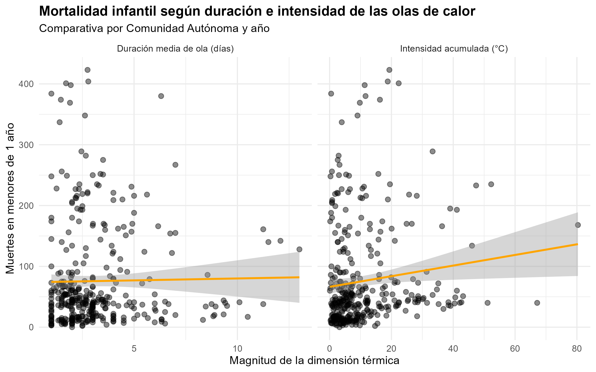
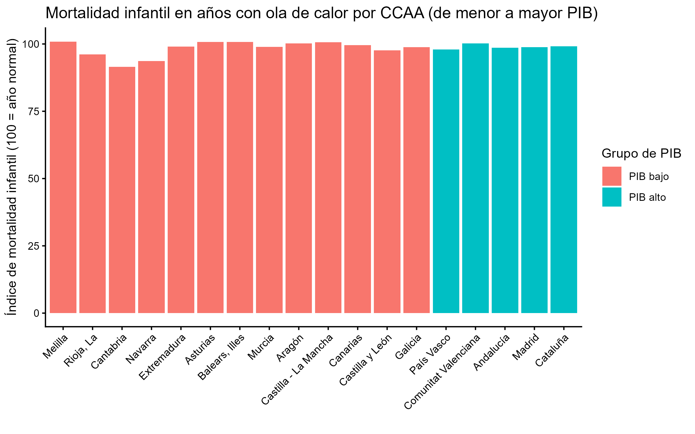
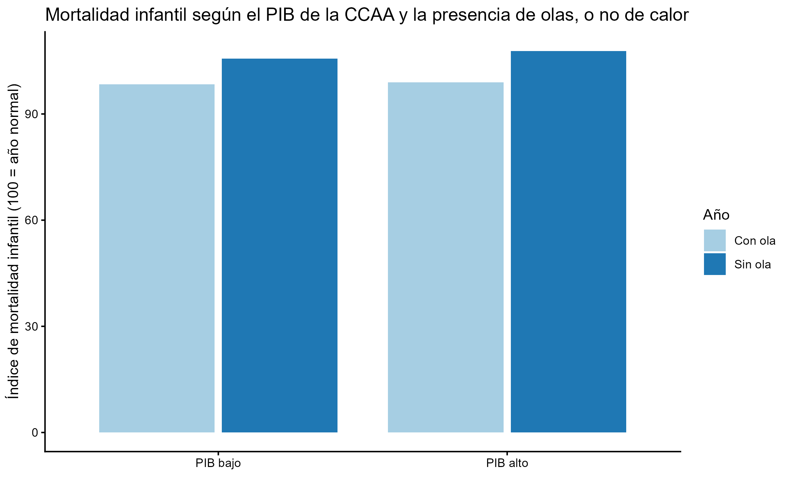

# Impacto de olas de calor en la mortalidad infantil: el PIB como indicador de la capacidad de la adaptación

Autores: _Santiago Herrero, Paula Manrique y Margarita Aguzarova_  
Asignatura: _Fuentes de datos Biomédicos y Web Semántica_  
Grado: _Ingeniería de la Salud en la Universidad de Burgos_  

El cambio climático ha aumentado la frecuencia e intensidad de las olas de calor,
que afectan especialmente a los menores de un año por su termorregulación inmadura. 
Las comunidades con mayor PIB podrían estar mejor preparadas para reducir el impacto. 
En este seminario se analiza si existe relación entre las olas de calor, la mortalidad infantil 
y el PIB por comunidad autónoma en España entre 2001 y 2025.

## Objetivo general
El objetivo general de este seminario es estudiar si existe alguna relación entre las olas de calor y la mortalidad infantil en las comunidades autónomas de España durante el periodo 2000-2025, teniendo en cuenta el producto interior bruto (PIB) como posible factor que pueda afectar esa relación.

## Objetivos específicos 
1. Estudio de la relación entre el número de olas de calor y la mortalidad infantil por comunidades autónomas en el periodo 2001-2025.

2. Cuál de las dos dimensiones de olas de calor (frecuencia e intensidad) ejerce un mayor impacto sobre la mortalidad infantil. 

3. Comparación de la mortalidad infantil durante los años con olas de calor entre comunidades autónomas con distinto PIB.

## Resultados

### ¿Cómo varía la mortalidad infantil según el número de olas de calor en cada comunidad autónoma?

### ¿Qué dimensión de las olas de calor (intensidad o duración) ejerce un mayor impacto sobre la mortalidad infantil?

### ¿Cómo varía la mortalidad infantil durante los años con olas de calor entre las comunidades autónomas con distinto PIB?

## Conclusiones
No se observa ninguna relación clara entre las olas de calor y la mortalidad infantil. 
El número y la duración de las olas no se asocian con más muertes. La intensidad muestra una ligera tendencia, pero no es concluyente, y el PIB no modifica de manera importante
esta relación. La principal limitación es que los datos de mortalidad son anuales, mientras los datos de olas de calor son diarios, lo que impide aislar
las muertes ocurridas durante cada ola de calor.

## Estructura del proyecto
- 'INPUT/DATA': Contiene dos archivos JSON y un archivo RData  
- 'olasCalor.html': el informe del seminario en formato HTML.
- 'olasCalor.Rmd': el informe del seminario, que genera el HTML con los resultados.
- 'OUTPUT/DATA': Contiene dos tablas (una de mortalidad y otra de PIB) 
- 'OUTPUT/GRAPHICS': Contiene las gráficas de representación de datos y las gráficas de las preguntas para no tener la necesidad de volver a ejecutar el código.
- 'README.md': la pequeña desripción del proyecto
- 'Referencias.bib': fuentes bibliográficas de los datos usados.
- 'seminario.R': el código.
- 'seminarioPrueba.Rproj': el proyecto de RStudio.

